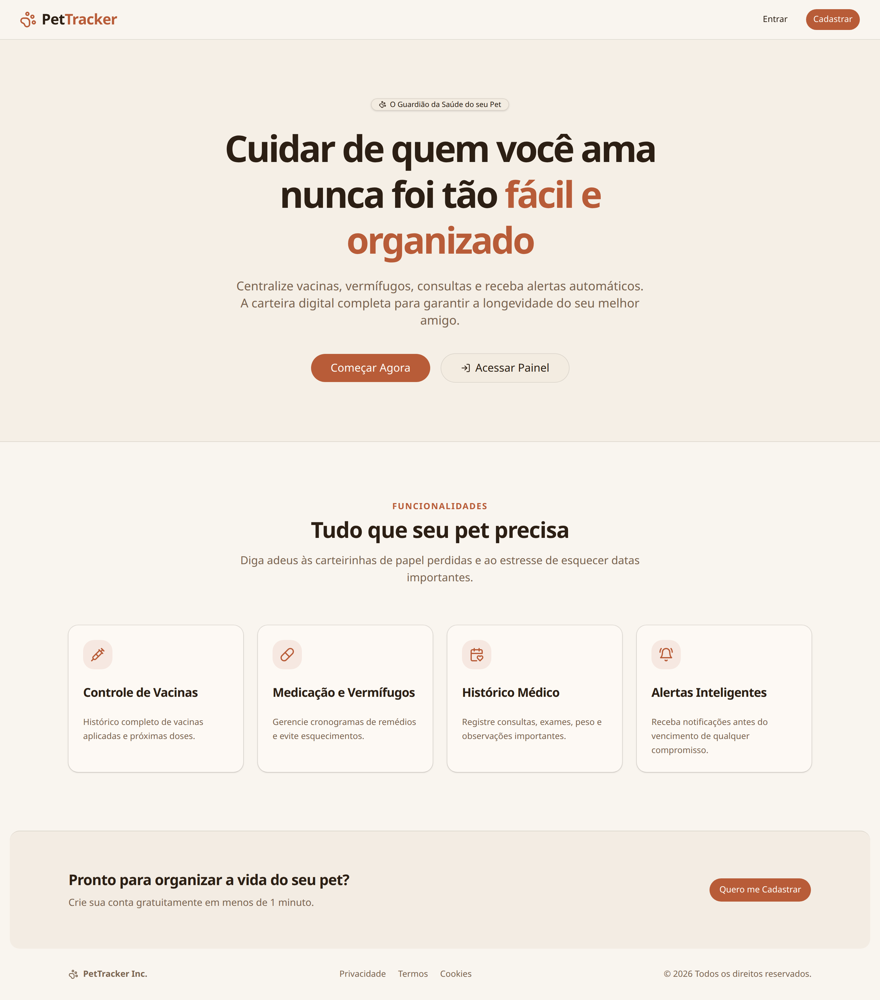
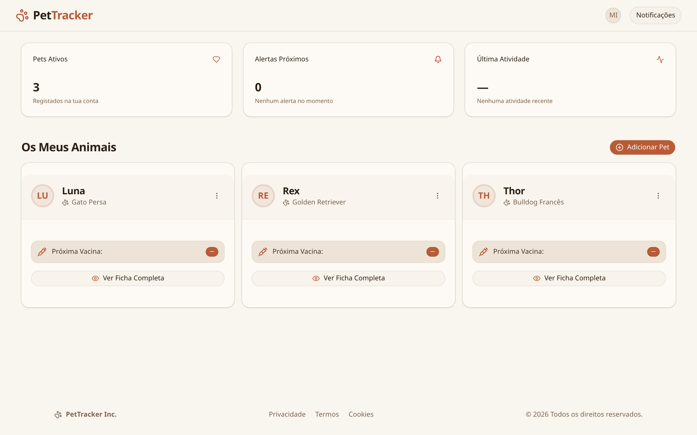
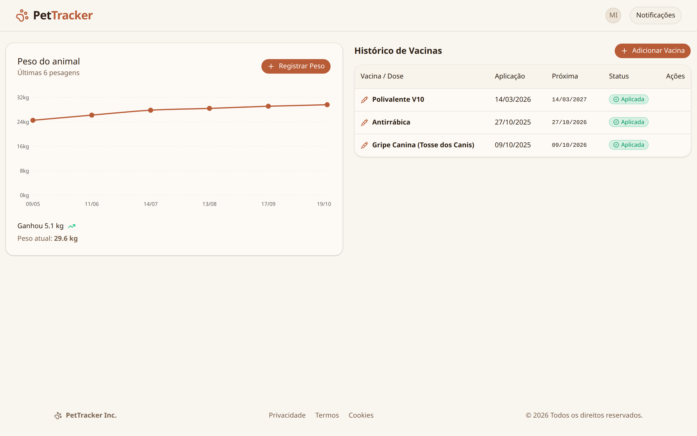
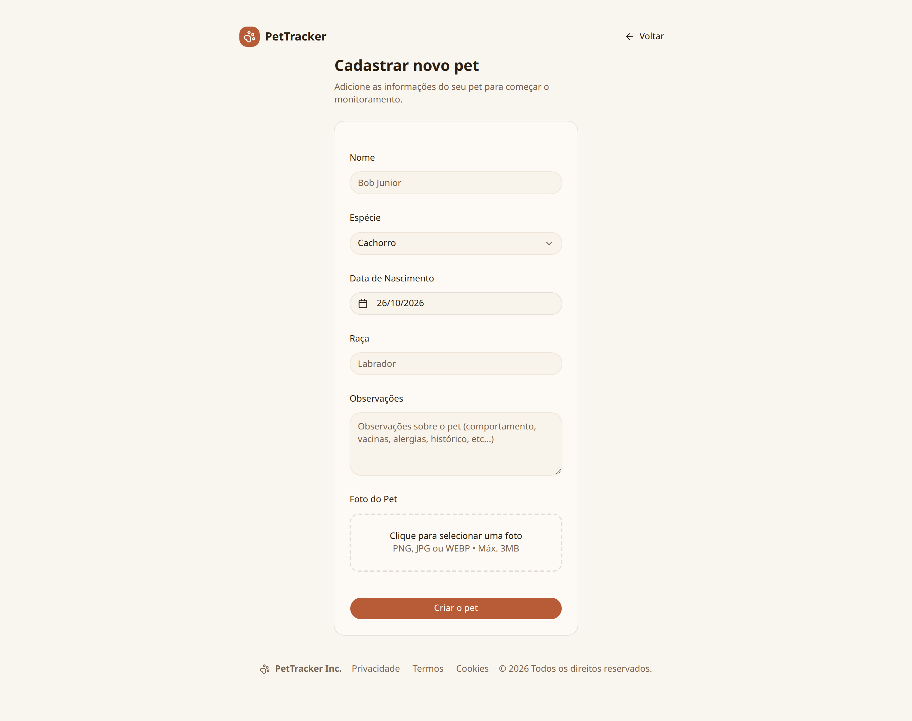
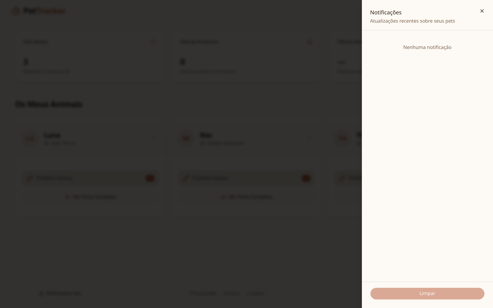
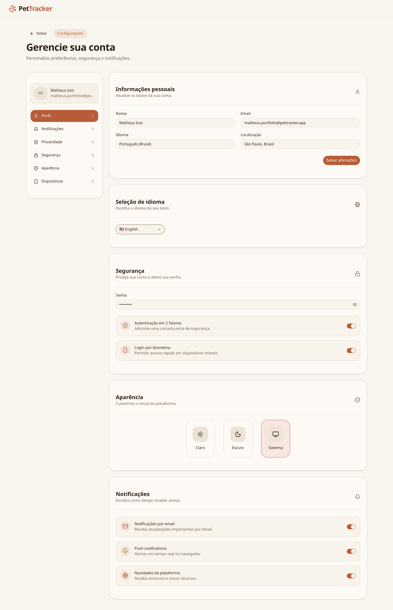
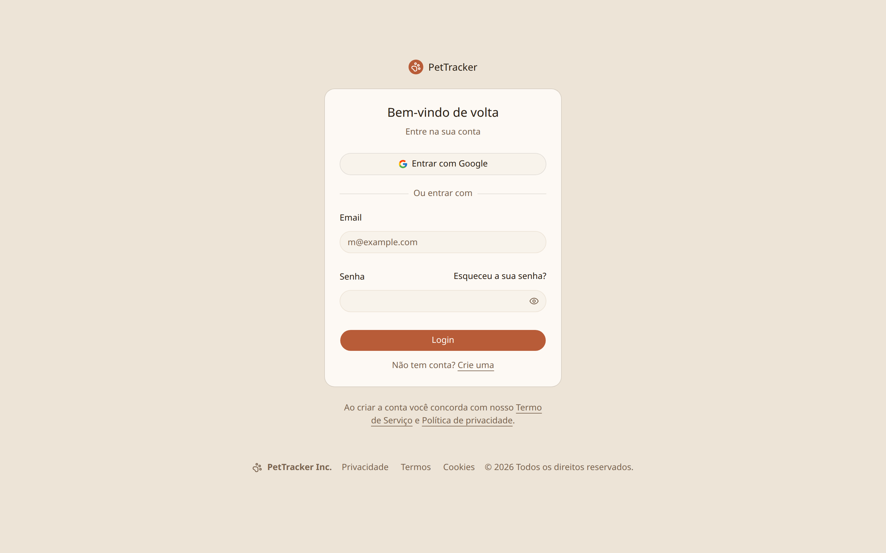
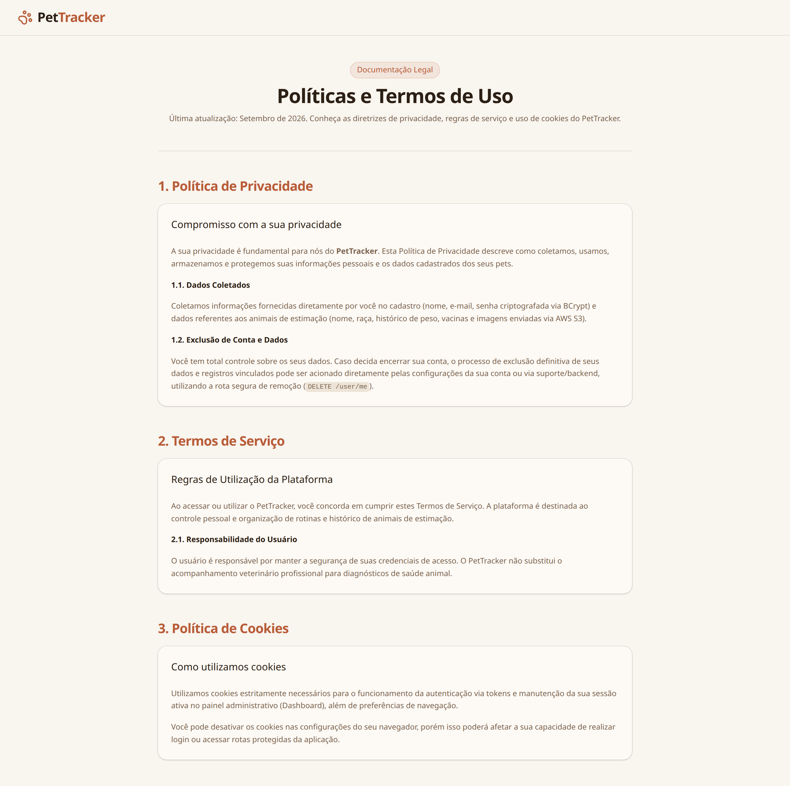

# 🐾 PetTracker Web

[](https://nextjs.org/)
[](https://react.dev/)
[](https://www.typescriptlang.org/)
[](https://tailwindcss.com/)
[](LICENSE)

A modern, full-stack pet health and lifecycle management web application. **PetTracker** helps pet owners organize, monitor, and care for their animals through comprehensive pet profiles, vaccination records, weight tracking charts, real-time notifications, multi-language support, and cloud image storage.

---

## 📑 Table of Contents

- [✨ Features](#-features)
- [📸 Application Showcase](#-application-showcase)
- [🛠️ Tech Stack](#️-tech-stack)
- [📂 Project Structure](#-project-structure)
- [🚀 Getting Started](#-getting-started)
  - [Prerequisites](#prerequisites)
  - [Installation](#installation)
  - [Environment Variables](#environment-variables)
  - [Running Locally](#running-locally)
- [📜 Available Scripts](#-available-scripts)
- [🔗 Backend API Integration](#-backend-api-integration)
- [📝 Changelog](#-changelog)
- [👨‍💻 Author](#-author)
- [📄 License](#-license)

---

## ✨ Features

### 🐶 Comprehensive Pet Management
- **Pet Profiles**: Register pets with details including species, breed, gender, birth date, and avatar.
- **CRUD Operations**: Easily create, view, update, and remove pet records.
- **Detailed View**: Dedicated dashboard overview for each individual pet.

### 💉 Vaccination Tracking
- **Dose History**: Log vaccine records including name, application date, and upcoming dosage schedule.
- **Management Dialogs**: Add and delete vaccines directly with validation and immediate UI synchronization.

### 📈 Weight & Growth Tracking
- **Interactive Charts**: Dynamic weight progression charts powered by **Recharts**.
- **Weight History**: Add and record periodic pet weight updates to monitor long-term health trends.

### 🔐 Authentication & Security
- **Email & Password Authentication**: Secure user registration and login flows.
- **Google OAuth 2.0 (SSO)**: One-click sign-in with Google and automated callback handling.
- **Token Management**: JWT access tokens and refresh tokens handled securely via HTTP-only cookies.
- **Route Guarding**: Protected route proxy (`src/proxy.ts`) safeguarding `/dashboard`, `/pets`, and `/settings`.

### 🔔 Notification Center
- **Interactive Drawer**: Slide-out notification sheet powered by Radix UI.
- **Status Badges**: Unread notification counter badge and dismissible notification cards.

### 🌓 Theming & Customization
- **Dark & Light Modes**: Seamless theme switching with persistence via `next-themes`.
- **Theme Preferences**: Toggle theme directly from the header or settings panel.

### 🌐 Internationalization (i18n)
- **Multi-language Support**: Powered by `next-intl`.
- **Supported Locales**: English (`en`) and Portuguese (`pt`).
- **Language Switcher**: Intuitive selector in the header and settings page.

### ☁️ Cloud Media Uploads
- **Drag-and-Drop Uploader**: Seamless avatar uploads via `react-dropzone`.
- **Cloud Storage**: Integrated with AWS S3 for reliable pet image storage and delivery.

### ⚖️ Legal & Privacy Portal
- Dedicated `/legal` route with organized sections for **Privacy Policy**, **Terms of Service**, and **Cookie Policy**.

---

## 📸 Application Showcase

### Landing Page & Dashboard

| Landing Page | Pet Dashboard |
| :---: | :---: |
|  |  |

### Pet Health & Details

| Pet Profile & Health Charts | Add Pet Form |
| :---: | :---: |
|  |  |

### Notifications & Settings

| Notification Center | User Settings & Preferences |
| :---: | :---: |
|  |  |

### Authentication & Legal

| Sign In (with Google OAuth) | Legal & Privacy Portal |
| :---: | :---: |
|  |  |

---

## 🛠️ Tech Stack

### Core Framework
- **[Next.js 16](https://nextjs.org/)** (App Router, Server Actions)
- **[React 19](https://react.dev/)**
- **[TypeScript 5](https://www.typescriptlang.org/)**

### UI & Styling
- **[Tailwind CSS v4](https://tailwindcss.com/)** - Utility-first styling
- **[shadcn/ui](https://ui.shadcn.com/)** & **[Radix UI](https://www.radix-ui.com/)** - Accessible UI primitives
- **[Lucide React](https://lucide.dev/)** & **[React Icons](https://react-icons.github.io/react-icons/)** - Icon sets
- **[Sonner](https://sonner.emilkowal.ski/)** - Opinionated toast notifications
- **[next-themes](https://github.com/pacocoursey/next-themes)** - Dark and light theme switcher

### Forms & Validation
- **[React Hook Form](https://react-hook-form.com/)** - Lightweight form state management
- **[Zod](https://zod.dev/)** - Schema validation and type inference

### Data Visualization & Media
- **[Recharts](https://recharts.org/)** - Composable charting library
- **[react-dropzone](https://react-dropzone.js.org/)** - Drag-and-drop file uploader

### Internationalization & Networking
- **[next-intl](https://next-intl-docs.vercel.app/)** - Localization framework
- **[Axios](https://axios-http.com/)** - HTTP client for API communication

---

## 📂 Project Structure

```text
pet-tracker-web/
├── docs/                   # Documentation screenshots and assets
├── public/                 # Static assets and icons
├── src/
│   ├── actions/            # Next.js Server Actions
│   │   ├── auth/           # Authentication actions (login, signup, logout)
│   │   ├── notifications/  # Notification actions
│   │   ├── pets/           # Pet management CRUD actions
│   │   ├── user/           # User profile actions
│   │   ├── vaccines/       # Vaccination tracking actions
│   │   └── weight/         # Weight record actions
│   ├── app/                # Next.js App Router pages and layouts
│   │   ├── addpet/         # Add pet page
│   │   ├── auth/           # OAuth callbacks (Google)
│   │   ├── dashboard/      # Main dashboard & pet details routes
│   │   ├── legal/          # Terms, privacy policy & cookies
│   │   ├── login/          # User login
│   │   ├── settings/       # Profile, preferences, and theme settings
│   │   ├── signup/         # Account creation
│   │   └── layout.tsx      # Root application layout
│   ├── components/         # Reusable UI and layout components
│   │   ├── forms/          # Form components (login, signup, pet creation)
│   │   ├── notifications/  # Notification sheet and cards
│   │   └── ui/             # shadcn/ui components, charts, tables
│   ├── contexts/           # React context providers (AuthContext)
│   ├── hooks/              # Custom React hooks (useAuth, etc.)
│   ├── i18n/               # Internationalization config
│   ├── messages/           # Translation JSON catalogs (en, pt)
│   ├── services/           # API clients and server fetch utilities
│   ├── types/              # TypeScript interfaces and Zod schemas
│   ├── utils/              # Helper functions and utilities
│   └── proxy.ts            # Authentication proxy for protected routes
├── .env.example            # Environment variables example template
├── package.json            # Project dependencies and scripts
├── pnpm-lock.yaml          # Lockfile
└── tsconfig.json           # TypeScript configuration
```

---

## 🚀 Getting Started

### Prerequisites

Make sure you have installed:
- **Node.js** 20.x or higher
- **pnpm** (recommended), or npm / yarn / bun

### Installation

1. **Clone the repository:**

   ```bash
   git clone https://github.com/theusinhoiost/pet-tracker-web.git
   cd pet-tracker-web
   ```

2. **Install dependencies:**

   ```bash
   pnpm install
   # or: npm install / yarn install / bun install
   ```

### Environment Variables

Copy the example environment configuration:

```bash
cp .env.example .env.local
```

Configure the environment variables in `.env.local`:

```env
# Application environment
NODE_ENV=development

# URL of the PetTracker Backend API
NEXT_PUBLIC_API_URL=http://localhost:3001/api

# Optional: set to "true" to disable route protection during local testing
DISABLE_AUTH_MIDDLEWARE=false
```

### Running Locally

Start the development server:

```bash
pnpm dev
# or: npm run dev
```

Open your browser and navigate to:

```text
http://localhost:3000
```

---

## 📜 Available Scripts

| Command | Description |
| :--- | :--- |
| `pnpm dev` | Starts the Next.js development server with Hot Module Replacement |
| `pnpm build` | Compiles the production build |
| `pnpm start` | Runs the compiled production server |
| `pnpm lint` | Runs ESLint to check for code quality and syntax issues |

---

## 🔗 Backend API Integration

This frontend application is designed to communicate with the **PetTracker Backend API** built with **NestJS**.

Key backend features utilized by this application:
- **JWT Authentication & Refresh Tokens**: Cookie-backed stateless authentication.
- **OAuth 2.0**: Google identity verification and account provisioning.
- **AWS S3 File Storage**: Pre-signed uploads and secure storage for pet avatars.
- **Relational Database**: Persistent pet, vaccination, weight, and user records.
- **RESTful Endpoints**: Predictable resource-oriented API design.

---

## 📝 Changelog

See [CHANGELOG.md](CHANGELOG.md) for a detailed history of changes, new features, and version releases.

---

## 👨‍💻 Author

**Matheus Iost**

- GitHub: [@theusinhoiost](https://github.com/theusinhoiost)
- Email: [theusinhoiost@users.noreply.github.com](mailto:theusinhoiost@users.noreply.github.com)

---

## 📄 License

This project is licensed under the [MIT License](LICENSE).
